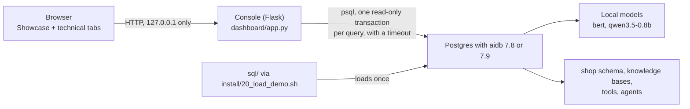

# AIDB in plain English

A live demo of EDB Postgres AI AIDB (7.8 and 7.9), with a sample dataset and a read-only introspector for engineers. A small
online outdoor-gear shop (*Northwind Outdoors*) lives in Postgres, AIDB adds models, a semantic layer, document search
and agents on top, and a local web console tells the story in seven guided steps, with a map of every function, table,
type and setting behind it.

The point of the demo: AI is a set of commands inside the database you already run. Models, keys, search by meaning
and agents are objects you create, grant and audit with SQL, so the same controls that protect your data apply to them.

> Unofficial demo material. All data is synthetic. See the product documentation at
> https://www.enterprisedb.com/docs/aidb/ for supported behaviour.

## Architecture



| Component | Role | Port |
| --- | --- | --- |
| `dashboard/app.py` (Flask) | Serves the page and runs every query through your own `psql` | 8643 (loopback only) |
| `psql` | The only way the console reaches Postgres. Works where security agents allow `psql` but block other clients | n/a |
| Postgres with `aidb` | The product being shown | 5432 |
| Local models (`bert`, `qwen3.5-0.8b-Q8_0`) | Run inside Postgres. Their files download from Hugging Face on first use | n/a |

## What the console shows

| Tab | What to look at |
| --- | --- |
| Showcase | Seven guided steps for business audiences: AI inside, Models, Keys, Your data, Ask, Agents, Health. Tick Presenter notes for a talking point per step. Each step has ready-to-run SQL under its live panel |
| Overview | Installed and available versions, preload status, workers, and one coloured mark per function |
| Functions | Search every function. Open one for its parameters, a ready-to-edit call and its source. Press `/` to jump to search |
| Tables & views | Browse the catalog tables and open their first rows |
| Types | Enums, including the valid values for options such as `auto_processing` |
| Settings | Every `aidb.*` setting, with risky ones flagged |
| Live objects | Models, credentials, providers, semantic knowledge bases, agent plugins (7.9+), tools, aliases, volumes and pipeline errors |
| SQL console | Run SQL and psql describe commands. Ctrl or Cmd + Enter runs the selection |
| Compare versions | Download a snapshot on an older server, load it here, and see what changed |

**Showing what 7.9 added:** on a 7.8 server press **Download snapshot** in Compare versions. On the 7.9 server choose
**Compare with a snapshot file**. The agent plugin functions (`aidb.create_agent_plugin()`, `aidb.update_agent_plugin()`,
`aidb.delete_agent_plugin()`), the semantic knowledge base context functions (`aidb.update_semantic_kb_context()`,
`aidb.process_semantic_kb_context()`, `aidb.update_semantic_kb_history_filter()`) and the `aidb.agent_plugins_registry`
table appear as new.

Not sure what is set up? In the Showcase press **Demo readiness**. It lists what exists, what is missing, and which
script creates each missing piece.

## Quick start

Requirements: Python 3.8+, the `psql` client, and a Postgres database with `aidb` installed
(`CREATE EXTENSION aidb CASCADE;`). Use a test database: the setup scripts write to it.

```bash
git clone https://github.com/francksidi-edb/aidb-showcase.git
cd aidb-showcase

cp env.sh.example env.sh && $EDITOR env.sh   # host, port, database, user (git-ignored)
./install/00_check_prereqs.sh                # read-only check of python3, psql, connection, aidb
./install/10_setup_dashboard.sh              # .venv and requirements
./install/20_load_demo.sh                    # sample data, models, semantic layer, documents, agents
./reset-demo.sh                              # start the console
```

Open **http://127.0.0.1:8643**, press **Connect & scan**, then **Start the guided showcase**. See `install/` for what
each script does.

The console listens on `127.0.0.1` only and rejects other Host headers, because it runs queries with your credentials.
To reach it from another machine, use an SSH tunnel:

```bash
ssh -L 8643:127.0.0.1:8643 <user>@<host>
# then open http://localhost:8643
```

> **First-run downloads.** AIDB's built-in local models download their files from Hugging Face the first time they
> are used, so the Postgres server needs internet access once. The embedding model (`bert`) is small. The assistant
> model (`qwen3.5-0.8b-Q8_0`) is several hundred MB and downloads on the first agent question. If the server restricts
> outbound traffic, see [docs/egress.md](docs/egress.md).

## Run the demo

```bash
./reset-demo.sh                      # restart the console, keep the demo data
./reset-demo.sh --wipe               # also remove the demo objects and reload them (asks to confirm)
./reset-demo.sh --wipe --with-governance   # ...and load the optional read-only-role demo (needs a superuser)
./reset-demo.sh --port 8700          # another port for this run
./reset-demo.sh --status             # console, port, database and demo readiness

./stop-demo.sh                       # stop the console, keep the data
./install/99_smoke_test.sh           # page, logo, API guard and readiness
```

A suggested run order: step through the numbered tabs with the arrow keys. Show that a local model turns a sentence
into 384 numbers (step 2), that a key is stored but never shown (step 3), the route between two tables (step 4), a
question answered by meaning with no shared words (step 5), an assistant limited to a listed set of tools (step 6),
and an empty failure list (step 7). The full script, with what to click, what you should see and what to say, is in
[docs/demo-guide.md](docs/demo-guide.md). A 10-slide deck that follows the same story is in
`docs/AIDB-7.8-benefits-and-use-cases.pptx` (written for 7.8, not updated for 7.9).

Facts built into the data, so you know what a correct answer looks like: three customers ordered twice last month (Maya
Cohen, Noah Schmidt and Lucas Tanaka), and the help article "Returns and refunds" answers "How do I send back an item?"
without sharing those words.

To show how an agent is built and what it can use (settings, delegation, roles, structured answers and every native tool),
follow [docs/build-an-agent.md](docs/build-an-agent.md).

To demonstrate an assistant held to one role, run `./install/20_load_demo.sh --with-governance`, then ask
`shop_readonly_agent` a question in step 6. Its tool calls run as the read-only role `shop_readonly`.

## Safe by default

- Every console query runs in a **read-only transaction** with a timeout.
- Anything stored under names like `api_key`, `secret`, `password` or `bearer` is replaced with `••• redacted •••` on the
  server before it reaches the browser.
- Only the console's own page can call its API.

| Action | Where | What happens |
| --- | --- | --- |
| **Try it** on a model | Step 2 | Calls the model once. Hosted providers bill for tokens |
| **Ask** (search) | Step 5 | Calls the embedding model |
| **Ask** an agent | Step 6 | Records the conversation, so it writes. A confirmation box appears and the agent starts in read-only mode |
| **Allow writes** | SQL console | Turns off the guard for that session, after confirmation |

The setup scripts do write to your database: a `shop` schema, the AIDB objects listed in the
[demo guide](docs/demo-guide.md#the-demo-data), and with `--with-governance` a role named `shop_readonly`.
`./reset-demo.sh --wipe` (or `./install/20_load_demo.sh --reset`) removes everything they created.

## Moving to AIDB 7.9

AIDB 7.9.0 was released on 30 Oct 2026 ([release notes](https://www.enterprisedb.com/docs/aidb/latest/release-notes/7/aidb_7.9.0_rel_notes)). The demo targets 7.8 and 7.9. The release notes were
read against everything the demo SQL and console call, and nothing the demo uses was removed or renamed. That is a reading
of the notes, not a test on a 7.9 server.

- **Optional governance demo:** `--with-governance` calls `aidb.create_purpose()`. From 7.9 the purpose functions run with
  the caller's own privileges, so run it as a superuser or an `aidb_governance` member (the script already grants the role).
  It now warns, instead of quietly skipping, when `create_purpose` fails.
- **Agent memory:** `aidb.memory_add()` and `aidb.memory_search()` now require `namespace` and `actor_id`, and the old
  two-argument forms are gone. The demo does not use them. The console now files both under agents.
- **New in 7.9 and visible here:** agent plugins, a managed plugin for each semantic knowledge base (`plugin_name` in
  `aidb.list_semantic_kbs()`), and telemetry provenance (`source` and `principal` in `aidb_otel`). The SQL console has
  presets for them, Live objects lists agent plugins, and `sql/tour_queries.sql` has a "What 7.9 added" section. The
  `aidb_otel` tables are readable only by `aidb_governance` members by default.
- **If your server also runs the MCP endpoint** (not part of this demo): 7.9 refuses connections that `pg_hba.conf` admits
  without a password, no longer runs on PostgreSQL 14 or 15, and renames the supervisor to `aidb endpoints supervisor`.
  See the upgrade notes in the release notes.

## Repository layout

```
dashboard/        Flask console (app.py), config.json, requirements.txt, static/ (index.html, EDB logo)
sql/              the demo: sample data, models, semantic layer, documents, agents, readiness check, reset, tour queries
install/          numbered scripts: prerequisites, console environment, demo loader, smoke test
docs/             demo guide, build-an-agent guide, egress notes, and the 10-slide deck
env.sh.example    template for env.sh, your connection settings (env.sh is git-ignored)
reset-demo.sh     restart the console, optionally wipe and reload the demo
stop-demo.sh      stop the console
```

## What has been tested

Checked on 6 Nov 2026, after the move to this layout, on Postgres 16.15 **without** the `aidb` extension:

- **Sample data:** `sql/01_sample_data.sql` loads cleanly. Row counts match the demo guide (12 customers, 10 products,
  59 orders, 165 order items, 10 tickets, 14 articles), exactly three customers ordered twice last month, and no order
  has a zero total.
- **Scripts:** `00` to `99`, `reset-demo.sh` and `stop-demo.sh`: start, restart, `--status`, `--port`, a refused
  `--wipe` leaving the console and data untouched, and stop. The loader and readiness steps stop with a clear message
  when `aidb` is missing.
- **Console:** serves the page and logo, answers `/api/health`, refuses foreign Host headers and requests without its
  own header, blocks path traversal under `/static/`, runs queries in a read-only transaction (a `CREATE TABLE` is
  refused), and saves the connection to `dashboard/` with mode 0600.

Recorded by the original author before the move, not repeated since: every script after `01` against a stand-in `aidb`
schema that mirrors the documented function names (it catches typos and quoting errors, not real AIDB behaviour), and
all seven Showcase steps in a browser with mocked responses.

- **Not tested against a live AIDB 7.8 or 7.9 server.** Run `./install/20_load_demo.sh` and `--check` once before presenting.
  If a statement fails on your build, the error names it, and the syntax comes from the official docs:
  [models](https://www.enterprisedb.com/docs/aidb/latest/integrating-models/),
  [credentials](https://www.enterprisedb.com/docs/aidb/latest/integrating-models/credentials/),
  [semantic knowledge bases](https://www.enterprisedb.com/docs/aidb/latest/semantic-knowledge-bases/example/),
  [multi-pipeline knowledge bases](https://www.enterprisedb.com/docs/aidb/latest/knowledge-bases/multi-pipeline/),
  [agents](https://www.enterprisedb.com/docs/aidb/latest/agents/),
  [custom SQL tools](https://www.enterprisedb.com/docs/aidb/latest/tools/custom-sql-tools/),
  [7.8.0 release notes](https://www.enterprisedb.com/docs/aidb/latest/release-notes/7/aidb_7.8.0_rel_notes),
  [7.9.0 release notes](https://www.enterprisedb.com/docs/aidb/latest/release-notes/7/aidb_7.9.0_rel_notes).
- The knowledge base and agent lists find their tables by name (`knowledge_bases`, `agents`), which the docs confirm.

## Known limitations

- **Not verified on a live AIDB 7.8 or 7.9 server.** See above.
- **Small local model:** the default assistant model is tiny, so expect short, simple answers. For stronger answers,
  register a hosted model and run `SELECT * FROM aidb.update_agent('shop_analyst', model => 'your_model');`.
- **First use is slow:** a local model downloads once, which can take several minutes for the assistant model.
- **Closeness bars are relative:** they compare the results of one search with each other. They are not an absolute score.
- **One presenter:** the console runs on Flask's built-in server, bound to loopback. It is not a multi-user service.
- **Synthetic data:** twelve customers and a few dozen orders. Timings and rankings on real data will differ.

## Troubleshooting

| Symptom | Likely cause and fix |
| --- | --- |
| `psql` isn't on PATH | Start the console from a shell where `psql` runs. `./install/00_check_prereqs.sh` checks it |
| `reset-demo.sh` says it cannot connect | Fix `env.sh` (host, port, database, user, and `PGPASSWORD` or `~/.pgpass`), then rerun |
| The aidb extension isn't installed | `CREATE EXTENSION aidb CASCADE;`, or choose the right database |
| Setup stops with `egress denied: egress to host "huggingface.co" is not permitted by aidb.egress_allowlist` | The server restricts outbound traffic and the local models must download once. See [docs/egress.md](docs/egress.md) |
| Setup script stops with `permission denied` | Run it as a role that can create schemas, triggers and AIDB objects. A superuser is simplest |
| Setup hangs for minutes | A local model is downloading. Watch the Postgres `NOTICE` lines, or check the server has internet access |
| `operator does not exist: numeric = text` when running a saved query | AIDB passes `${month}` and `${year}` to saved queries as text, so `sql/03_semantic_layer.sql` casts them (`${month}::int`). Run `./install/20_load_demo.sh --from 03` to recreate the saved queries |
| Step 4 or 5 "Find data" errors | Run `./install/20_load_demo.sh --check`, then the script it names. If `shop_kb` shows 0 tables, wait a moment and run `SELECT * FROM aidb.semantic_kb_stats(kb_name => 'shop_kb');` again |
| Step 5 "Find documents" says nothing matched | Check the knowledge base name (`shop.shop_articles_kb`) and that `sql/04_documents.sql` ran without errors |
| Step 6 shows no agents | Run `sql/05_agents_and_tools.sql` (or `./install/20_load_demo.sh --from 05`) |
| Step 6 answer is wrong or empty | The default model is tiny. Switch the agent to a stronger model with `aidb.update_agent` |
| "That didn't run" on a card | Open **The SQL behind this** in the console to see the full error |
| No `aidb.*` settings shown | Add `aidb` to `shared_preload_libraries` and restart Postgres |
| Port 8643 in use, or `reset-demo.sh` stops with "Something else still holds port" | Use `./reset-demo.sh --port 8700`, or change `port` in `dashboard/config.json` |
| Console page is blank or "Couldn't reach the local server" | `./reset-demo.sh --status`, then check `.run/console.log` |

## Notes

- Connection details and credentials are not committed. See `.gitignore`. A connection saved from the page goes to
  `dashboard/.aidb_introspect_config.json` (mode 0600, git-ignored).
- The demo uses a placeholder credential (`demo_hosted_ai`), not a real key. Trying `demo_hosted_gpt` fails by design.
- This repository is a demo, not a product.
